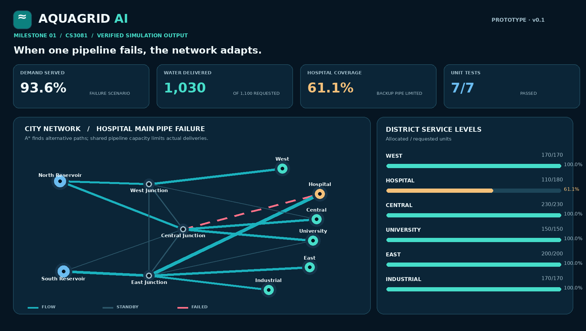
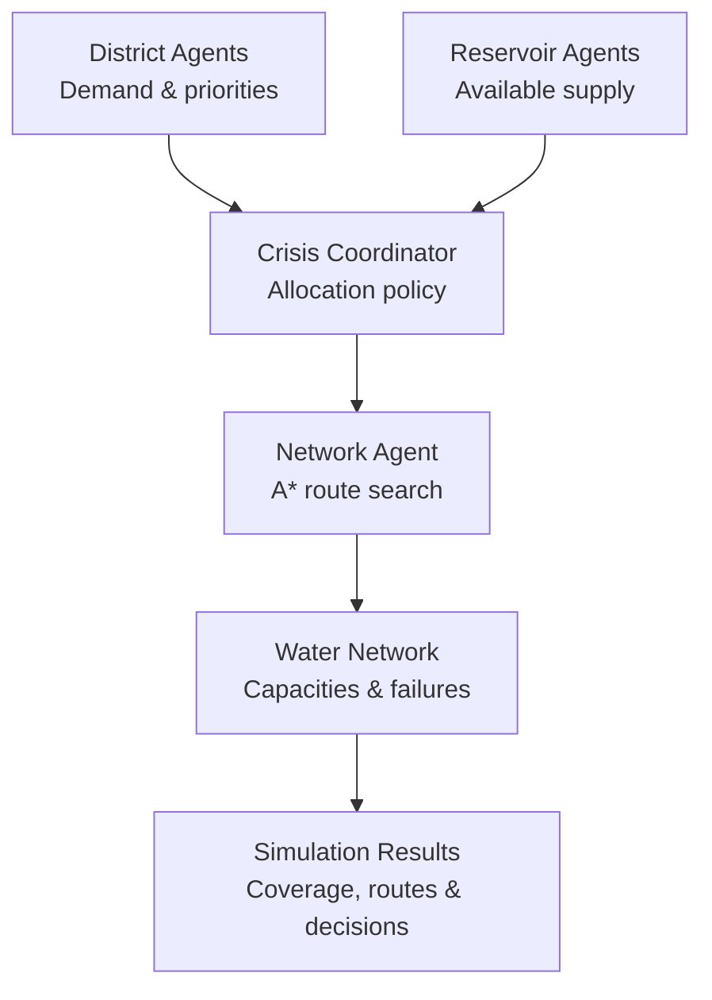

<div align="center">

# 🌊 AquaGrid AI
### Intelligent Water Distribution & Crisis Management

**A multi-agent simulation exploring how intelligent decision-making can improve resource allocation when urban infrastructure is under pressure.**



[](https://www.python.org/)
[](https://streamlit.io/)


**[Explore the simulation](#-getting-started) · [Architecture](#-system-architecture) · [Results](#-simulation-results) · [Roadmap](#-roadmap)**

</div>

---

## 💡 Overview

Water distribution becomes challenging when supply is limited, demand changes unexpectedly, or critical pipelines fail. **AquaGrid AI** investigates these challenges using a simulated city and multiple cooperating software agents.

The system models **2 reservoirs, 6 districts, 3 junctions, and 16 pipelines**. Agents represent district needs, available reservoir supply, network routing, and crisis coordination. They work together to allocate water while respecting resource and pipeline constraints.

> **Research question:** How can cooperative intelligent agents adapt water allocation when infrastructure fails or resources become scarce?

### Key capabilities

- 🧠 **Agent-based decisions** — four specialized roles coordinate allocation.
- 🗺️ **A* route search** — identifies feasible paths through a weighted pipeline network.
- 🚨 **Crisis scenarios** — evaluates failures, shortages, and demand spikes.
- 📊 **Interactive visualization** — inspect simulated water flows and district coverage.
- 🧪 **Reproducible experiments** — scenario outputs and automated tests.

## 🏗️ System architecture



| Component | Responsibility |
|---|---|
| **District Agent** | Creates water requests based on local demand and priority. |
| **Reservoir Agent** | Reports available supply and releases allocated water. |
| **Network Agent** | Searches for feasible routes using A* and checks pipeline availability. |
| **Crisis Coordinator** | Prioritizes critical demand and coordinates round-robin allocation for other districts. |

The current coordination policy is heuristic-based. A more decentralized negotiation mechanism is part of the future roadmap.

## 🚀 Getting started

### Requirements

- Python **3.10+** recommended for the optional dashboard
- A modern browser for the offline viewer

Clone the repository:

```bash
git clone https://github.com/azizdaim/AquaGrid-AI.git
cd AquaGrid-AI
```

### Option A: Interactive dashboard

Install dependencies and launch the live Python-backed Streamlit app:

```bash
python3 -m pip install -r requirements.txt
python3 -m streamlit run app.py
```

### Option B: Command-line simulation

The core simulation uses the Python standard library:

```bash
python3 demo.py --scenario normal
python3 demo.py --scenario pipe_failure
python3 demo.py --scenario drought
python3 demo.py --scenario combined
python3 demo.py --all
```

### Option C: Offline scenario explorer

Open **`AquaGrid_Demo.html`** in a browser (no install or internet connection needed). It replays **precomputed** engine output step by step:

- animated playback of every coordinator dispatch on the network map (play / pause / scrub / speed)
- click a district to inspect the A* routes used to supply it; hover pipes and nodes for loads and capacities
- auto-generated findings, a live decision log, and a cross-scenario comparison chart
- keyboard shortcuts: `1`–`5` scenario, `Space` play/pause, `←`/`→` step, `R` replay
- deep links, e.g. `AquaGrid_Demo.html#pipe_failure`

It is not a live Python execution environment. The page layout lives in `demo_template.html`; to regenerate the scenario data, re-run the tests and rebuild the HTML:

```bash
python3 export_demo.py
```

## 🧪 Simulation results

Five deterministic scenarios illustrate how resource constraints and disruptions affect service levels.

| Scenario | Total demand satisfied | Hospital demand satisfied |
|---|---:|---:|
| Normal operation | **100%** | 100% |
| Hospital pipeline failure | **93.6%** | 61.1% |
| Supply reduced to 65% | **78.0%** | 100% |
| Demand increased by 40% | **85.7%** | 100% |
| Combined crisis | **55.7%** | 43.7% |

**Example:** When the hospital's primary pipeline fails, the routing agent finds an alternate path, but its limited throughput prevents full hospital coverage. The system models the constraint instead of assuming rerouting can restore unlimited supply.

These are results from a **synthetic, single-step simulation**. They do not establish superiority over other allocation algorithms; comparative baselines are planned.

## 🛠️ Technology

| Area | Tools / methods |
|---|---|
| Simulation engine | Python |
| Pathfinding | A* search |
| Allocation | Priority-based and round-robin heuristics |
| Interactive dashboard | Streamlit, Plotly |
| Offline visualization | HTML |
| Testing | Python `unittest` |

## 📁 Repository structure

```text
AquaGrid-AI/
├── aquagrid/
│   ├── agents.py          # Agent roles, routing, coordination
│   ├── model.py           # Network and pipeline definitions
│   ├── scenarios.py       # Crisis configurations
│   └── simulator.py       # Simulation execution
├── tests/                 # Automated tests
├── outputs/               # Generated scenario data
├── app.py                 # Streamlit dashboard
├── demo.py                # Command-line interface
├── export_demo.py         # Offline scenario exporter (runs engine + tests)
├── demo_template.html     # Layout for the offline viewer
├── AquaGrid_Demo.html     # Offline interactive viewer
├── preview.png            # Network visualization
├── requirements.txt
└── README.md
```

## ✅ Testing

Run the automated test suite:

```bash
python3 -m unittest discover -s tests -v
```

The initial prototype includes **7 automated tests** for core simulation behavior.

## 🧭 Roadmap

- [x] Model a synthetic water distribution network
- [x] Implement agent roles and A* routing
- [x] Support multiple crisis scenarios
- [x] Build an interactive dashboard and offline explorer
- [x] Add initial automated tests
- [ ] Add dynamic, multi-timestep simulation
- [ ] Compare static, greedy, and coordinated allocation baselines
- [ ] Improve distributed agent negotiation
- [ ] Model uncertain sensor observations
- [ ] Expand evaluation, testing, and deployment

## 🔬 Scope and limitations

AquaGrid AI is an **experimental software simulation**, not a real-world utility control system. Water quantities are abstract units per allocation cycle. The current implementation does not model hydraulic pressure, sensor uncertainty, or long-term reservoir dynamics. Its allocation policy is not claimed to be globally optimal.

This project is being developed as part of computer science study, with a focus on AI reasoning, simulation, and software engineering. The initial prototype was developed with AI assistance; subsequent contributions and evaluations should be documented transparently.

---

<div align="center">

**AquaGrid AI** · Exploring resilient infrastructure through intelligent agents

*Built with Python · Developed and maintained by project contributors*

</div>
